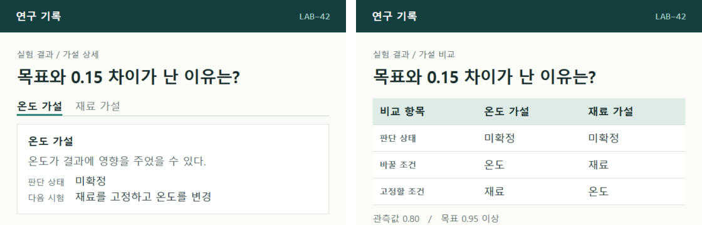

# Task First Frontend

사용자가 화면에서 **어떤 판단을 내리고 다음에 무엇을 해야 하는지**부터 살펴보는 Codex용 프론트엔드 설계 스킬입니다. 프로젝트의 코드와 실행 화면에서 그 과업을 찾고, 같은 데이터로 구조가 다른 시안을 만들어 비교합니다. 하나를 고르면 기존 기능에 연결하고 실제 사용 흐름을 확인할 수 있습니다.



**예를 들어, 다음 실험에서 무엇을 고정해야 할까요?** 왼쪽 화면에서는 두 가설을 번갈아 열어야 합니다. 오른쪽 시안에서는 같은 행을 따라가며 시험 조건을 비교할 수 있습니다. 두 가설의 판단 상태는 그대로 ‘미확정’입니다. 위 이미지는 공개 사례의 과업을 설명하려고 만든 교육용 화면 두 장을 이 스킬의 비교 스크립트로 합친 것입니다. [실제 설계 사례와 당시 만든 세 가지 방향](skills/task-first-frontend/references/case-study-and-coverage.md)

## 내 프로젝트에서 시작하기

기존 프로젝트를 Codex에서 열고, 설치한 스킬에 화면과 고민을 알려주세요.

```text
$task-first-frontend 결과 화면에서 사용자가 내려야 하는 판단을 코드와 실제 화면에서 찾아줘.
같은 데이터로 구조가 다른 시안 세 개를 만들고, 각각을 기존 화면과 나란히 보여줘.
이번에는 시안을 고르는 데까지 진행해줘.
```

**시안을 고를 때** 기존 화면과 각 시안을 같은 폭에서 비교하는 이미지를 받습니다. ‘출처 보드’에서는 참고한 화면의 일부분과 내 시안의 해당 부분을 나란히 보고, 무엇을 가져와 어떻게 바꿨는지 확인할 수 있습니다.

**구현을 맡길 때**는 “두 번째 시안을 구현하고, 결과에서 원문을 열었다가 같은 위치로 돌아오는지 확인해줘”처럼 선택한 안과 확인할 행동을 알려주세요. 구현 후에는 변경 전후 캡처와 항목별 검증 결과를 받습니다. 이미 고른 화면의 작은 수정은 현재 설계를 유지하고 바로 수정 범위에 집중합니다.

## 설치

Git으로 저장소를 복제합니다.

```sh
git clone https://github.com/hyperdrivebeep/task-first-frontend.git
```

복제한 저장소의 `skills/task-first-frontend` **폴더 전체**를 개인 Codex 스킬 디렉터리 `~/.codex/skills/`에 복사하세요. `CODEX_HOME`을 지정했다면 그 아래의 `skills/`를 사용합니다. 설치가 끝나면 새 Codex 대화에서 `$task-first-frontend`를 호출하세요.

단계 검사에는 **Node.js 18 이상**, 출처 보드와 비교 이미지 생성에는 **PATH에서 실행할 수 있는 FFmpeg**가 필요합니다. 실제 화면 캡처에는 브라우저가 필요하며, 이미지 생성 시안을 요청할 때는 해당 도구를 사용할 수 있어야 합니다.

## 각 단계에서 남는 것

| 단계 | 확인할 질문 | 작업 폴더의 산출물 |
| --- | --- | --- |
| S0 · 준비 | 이번 작업에 필요한 지침을 어디까지 읽었나? | `reading-ledger.md` |
| S1 · 과업 정의 | 누구의 어떤 행동이 끝나야 성공인가? 어떤 데이터·상태·화면 폭으로 비교할까? | `00-contract.md` |
| S2 · 기존 화면 | 같은 조건에서 현재 사용자는 무엇을 보나? | `01-before/` |
| S3 · 레퍼런스 | 다른 제품은 이 과업을 어떻게 풀며, 어떤 원리를 가져올 수 있나? | `02-refs/`의 방문 기록과 캡처 |
| S4 · 시안 비교 | 기본 세 시안은 구조가 어떻게 다르고 각 요소는 어디서 왔나? | `03-alts/`의 시안, 출처 보드, 기존 화면과의 비교판 |
| S5 · 설계 점검 | 어떤 UI 규칙을 충족했고 어떤 항목을 아직 확인해야 하나? | `04-verdicts.md` |
| S6 · 구현 | 선택한 시안이 실제 진입 경로에서 동작하나? 같은 상태에서 무엇이 달라졌나? | 제품 코드 변경과 `05-after/` 캡처 |
| S7 · 보고 | 어떤 변경을 어디서 확인할 수 있나? | 이미지·검증 결과와 브랜치 또는 PR 링크를 담은 `06-report.md` |

S1에서 상태별 안내와 다음 행동을 정하고 클라이언트 코드 리뷰가 필요한 이유를 기록합니다. 기존 코드 동작을 조사하면 S5에서 판정합니다. 저장·요청 등 동작을 바꾸면 S5에서 기대 결과를 정하고 S6에서 구현 후 증거로 확인합니다. 문구나 간격만 고치는 경우에는 생략 이유를 남깁니다.

**한 규칙이 어디에 쓰였는지도 따라갈 수 있습니다.** 결제 화면이라면 S1에서 190개 가드레일 중 결제 전 총액 표시(T-16)와 결제 결과 구분(T-17)을 적용 대상으로 정합니다. S4에서는 각 시안이 총액과 승인 버튼을 어디에 배치했는지 기록합니다. S5에서는 처리 중·거절·완료를 확인할 방법을 고르고, S6에서는 실제 화면과 주문 기록을 판정에 연결합니다. S7 보고서에서 적용·제외 사유, 시안 결정, 최종 근거로 이동할 수 있습니다. [규칙별 기록 예시](skills/task-first-frontend/references/work-folder.md#가드레일-적용-범위)

설계만 요청하면 S6을 건너뜁니다. 이미 선택한 시안의 작은 수정에서는 S3·S4를 건너뜁니다. 사용성 개선을 주장하려면 실제 사용자가 같은 과업을 수행한 결과가 필요합니다.

### 산출물 검사

Codex는 각 단계에서 `gate.mjs`를 실행합니다. 예를 들어 저장소 루트에서 아래 명령을 실행하면 지정한 작업 폴더의 S0부터 S4까지 다시 검사합니다. `./work`를 실제 산출물이 있는 폴더로 바꿔주세요.

```sh
node skills/task-first-frontend/scripts/gate.mjs ./work --stage 4
```

`RESULT: FAIL`이면 출력을 보고 해당 산출물을 고칩니다. 예를 들어 보드를 만든 뒤 시안 이미지를 바꾸면 입력 파일의 해시가 달라져 검사가 실패합니다. 이때 `node skills/task-first-frontend/scripts/compose.mjs ./work all`로 이미지를 다시 합성한 뒤 검사를 실행합니다. 결과가 `PASS`여도, 잘라낸 요소가 실제로 해당 과업에 적합한지는 보드를 보고 판단해야 합니다. [작업 폴더 형식과 검사 기준](skills/task-first-frontend/references/work-folder.md)

## 더 읽기

- **스킬 사용 범위** · [스킬 지침](skills/task-first-frontend/SKILL.md) · [도구와 인계](skills/task-first-frontend/references/tools-and-scope.md)
- **설계 과정** · [코드에서 과업 찾기](skills/task-first-frontend/references/discovery-and-tasks.md) · [화면 관찰과 레퍼런스 조사](skills/task-first-frontend/references/audit-and-research.md) · [시안 비교](skills/task-first-frontend/references/design-and-ideation.md)
- **검증 기준** · [UI·UX 규칙](skills/task-first-frontend/references/guardrails/README.md) · [UI 검증](skills/task-first-frontend/references/verification/README.md) · [구현과 전후 비교](skills/task-first-frontend/references/implementation-and-validation.md)
- **작업 예시** · [설계 문서 양식](skills/task-first-frontend/assets/design-brief-template.md) · [세 시안의 이미지 생성 프롬프트](skills/task-first-frontend/references/example-image-prompts.md)

A Codex skill for redesigning interfaces around user tasks. Compare alternatives on the same data, trace design choices to reference screenshots, and verify the selected implementation. The guide is in Korean.
